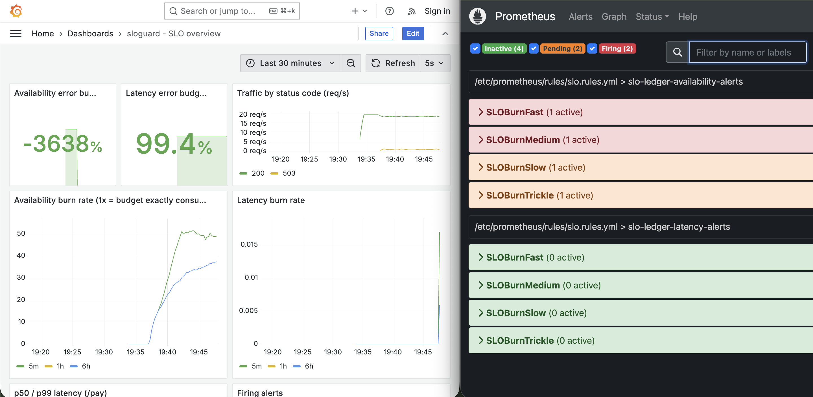

# sloguard



**SLO as code built for alerting as a Go service. The YAML reliability spec compiles into multiwindow with multi burn rate Prometheus alerts. These alerts are unit tested and proven against injected faults & the same service deploys to Azure Container Apps through a reusable terraform module.**

## The problem

Threshold alerts ("5xx rate > 1%", "CPU > 80%") page/notify people for blips that don't matter and typically stay silent about slow leaks that quietly eat the quarter's reliability target. These written alert rules also drift and nobody can say whether they work until a real outage has occured.

1. Targets live in one file (`slo/slos.yaml`).
2. Alerts are **generated** from it (`tools/gen_rules.py`) using a burn rate method developed from the Google SRE Workbook: page when the error budget is burning fast over *both* a long and a short window, ticket when it is leaking slowly.
3. All alert behaviour is **tested twice**: with `promtool` unit tests on synthetic traffic and live by injecting faults into the running service and then watching a page arrive.
4. CI fails if the committed rules drift from the spec.


## Quickstart (local, ~5 minutes, needs Docker)

```bash
make up           # builds the image, starts 6 containers
```

| URL | What |
|---|---|
| http://localhost:3000 | Grafana, "sloguard - SLO overview" (burn rates, budget remaining, p50/p99) |
| http://localhost:9090/alerts | Prometheus alert states |
| http://localhost:9093 | Alertmanager |

## Broken/simulated on purpose

```bash
make alerts            # terminal 1: shows only what the "pager" receives
make chaos-errors      # terminal 2: 5% of /pay requests start returning 503
```

Observed on a clean start: `SLOBurnFast` goes *pending* within one evaluation then it *fires* after its `for: 1m`, and the page lands in `alertsink` **about 2 minutes** after injection. Then:

```bash
make chaos-reset       # the page resolves itself as soon as the 5 minute window clears (allow several minutes)
make chaos-latency     # +450ms on every request: the *latency* SLO pages instead (~1.5 min observed)
```

Slower tiers (`SLOBurnSlow`, `SLOBurnTrickle`) stay at the pending/ticket level and are *inhibited* while a page for the same SLO is active: one incident & one notification.

## Reasoning and cost effectiveness

**1. Alert on error budget burn rate not on thresholds.** Burn rate 1x would mean "the whole 30 day budget is consumed exactly at day 30." Page at 14.4x (2% of budget in 1h) and 6x (5% in 6h), ticket at 3x and 1x. Each alert requires a long window *and* a short window in order to exceed the threshold. So a spike that already ended doen't page here (test: `resolved incident does not page`). Cost: more rules and more to explain than `rate > x`; windows and `for` durations are tuned as "demo" speed and should be revisited per service.

**2. Generate rules from a spec as opposed to writing PromQL by hand.** The generator validates the spec (ex: a latency threshold must be an exact histogram bucket otherwise the "good events" count is silently wrong) and CI checks for drift. I didn't use Sloth/Pyrra: a ~200-line generator keeps the logic reviewable here at the cost of supporting only availability and latency SLIs in turn.

**3. Zero third party Go dependencies.** The service implements the Prometheus text exposition format itself (lock free counters and histograms, bounded label cardinality, fixed route labels). Result = an empty dependency tree and a distroless static image. Cost: I own the format & there's no Go runtime/process metrics. For anything past this scope I'd just switch over to `client_golang`.

**4. SLI hygiene.** `/healthz` isn't instrumented (probes would flatter availability); 4xx responses don't burn the budget; client aborts are recorded as 499, not 5xx; request timeouts are 504 and *do* burn budget; the error ratio uses `or vector(0)` because an absent 5xx series would otherwise make the whole ratio empty (test: `zero errors yields zero not no-data`).

**5. Azure Container Apps + GHCR instead of AKS + ACR.** For one stateless HTTP service, a managed Kubernetes control plane plus node pool is cost and operational surface with no benefit; Container Apps gives probes, HTTP autoscaling and revisions. Images come from GHCR so there is no registry credential and no "registry must exist before the app" chicken-and-egg. Cost: the package must be public, and there is no sidecar/operator ecosystem.

**6. Terraform guard-rails live in the module.** `image` must carry an immutable tag (a mutable `:latest` makes `apply` a silent no-op after a push), `min_replicas >= 1` (scale-to-zero would erase the SLI), the Log Analytics workspace has a daily ingestion cap, and `/metrics` is protected by a generated bearer token.

## Deploying to azure

```bash
./scripts/azure-prereqs.sh                      # providers + prints ARM_SUBSCRIPTION_ID
export ARM_SUBSCRIPTION_ID=<printed value>
cd infra/envs/dev
cp terraform.tfvars.example terraform.tfvars    # set image = ghcr.io/<you>/sloguard:sha-<7 chars from CI summary>
terraform init && terraform plan && terraform apply
cd ../../.. && ./scripts/attach-azure.sh         # points local Prometheus at the Azure URL
make loadgen-azure                               # traffic; check http://localhost:9090/targets
terraform -chdir=infra/envs/dev destroy          # when done
```

Optional remote state: `scripts/bootstrap-tfstate.sh`, then copy `backend.tf.example` to `backend.tf`.

## Testing

| Command | Covers |
|---|---|
| `make test-go` | metrics format (cumulative buckets, `le` inclusivity, cardinality bounds), fault validation, bearer auth, handler behaviour incl. 504 timeouts |
| `make test-py` | generator maths, spec validation, committed rules not stale |
| `make test-rules` | `promtool check` + 5 unit-test scenarios: sustained burn pages, ended incident does not, healthy is silent, no-5xx-series gives 0, latency SLO pages |
| CI | all of the above plus `go test -race`, `terraform fmt/validate`, image build and push |

## Repo layout

```
slo/slos.yaml                      reliability spec 
tools/gen_rules.py                 spec -> Prometheus rules (+ tests)
observability/                     prometheus, alertmanager, grafana (provisioned as code)
app/cmd/{ledger,loadgen,alertsink} three binaries (one distroless image)
app/internal/{metrics,fault,auth}  exposition format, fault injection, bearer guard
infra/modules/container_app_service reusable Terraform module
infra/envs/dev                     environment composition
scripts/                           azure prereqs, state bootstrap, prometheus attach
compose.yaml, Makefile             local stack & every command above
```

## Limitations and what I'd do next

- The bearer token is in a Terraform state (a generated `random_password`). possible implementation here: Key Vault reference plus managed identity.
- Deploys are manual `terraform apply`; next: GitHub OIDC federation
- Prometheus is a single local instance scraping a public endpoint though if in prod an Azure managed prometheus or network agent with a real reciever such as PagerDuty or Slack
- Burn windows/`for` values are demo-tuned when it'd come to real services its more ideal for them to be tuned to traffic volume.

## Clean up
```
az containerapp delete ...
terraform apply
```